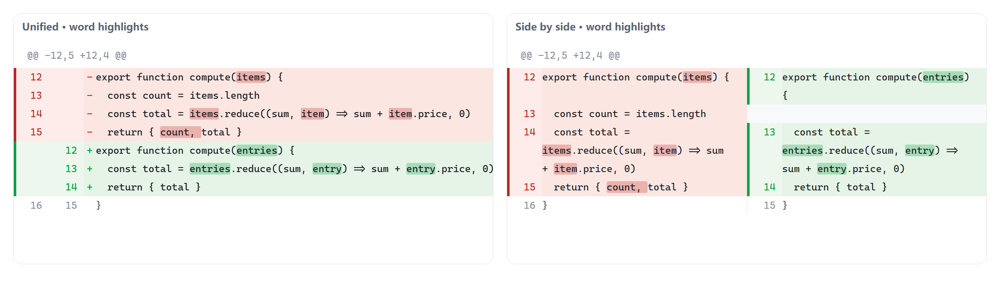

# dsh-word-diff

Word-level (intra-line) diff highlighting for the **changed-files review** in the
[DeepSeek Harness](https://github.com/deepseek-ai) Web GUI. A removed line keeps its red
background and the words it lost get a *deeper* red; an added line keeps its green
background and the words it gained get a *brighter* green — the way Claude Code and
VS Code show a word diff, instead of painting the whole line.



> 改动审阅里的行内高亮：删除行内的被删片段用更深的红，新增行内的新增片段用更亮的绿 ——
> 类似 Claude Code / VS Code 的逐词 diff，而不是整行染色。支持统一 / 双栏、自动换行，
> 并记住你的视图偏好。

## Features

- **Intra-line marks** on rewritten lines: deeper red for removed words, brighter green
  for inserted words, on top of the usual line backgrounds.
- **Only rewrites are marked.** A purely added or purely deleted line keeps nothing but
  its line background, so the view never turns into a wall of highlight.
- **Survives a whole-file replacement.** When the Host's own comparison degrades to
  "every line deleted, every line added" — because the file only changed its line endings
  (CRLF ↔ LF), or because its line diff hit the Host's 100 ms timeout — the plugin rebuilds
  the comparison from the two sides it carries and shows the real edits again.
- **Unified and side-by-side** layouts; side-by-side pairs each removal with the addition
  that rewrote it (git-style similarity alignment), not by blind position.
- **Wrap toggle** that really wraps (long lines fold in unified view, clip per column in
  side-by-side when off).
- **Remembers your layout**: the wrap and side-by-side/unified choices persist in the
  browser, so every review and every reload opens the way you left it.
- **Theme-aware** (light / dark) through DSH design tokens, with English and 中文 copy.
- **Non-invasive**: reads the Host's own change routes, patches no shipped file, and hands
  the tab back to the built-in view when disabled or removed.

## Install

Requires a DeepSeek Harness installation with the Web GUI. The package is not published to
npm; install it from source. Any one of these works:

### 1. Clone, then add the folder as a plugin (recommended)

```bash
git clone https://github.com/georgeseeker/dsh-word-diff.git
```

In the Web GUI open **Plugins → Add plugin** and point it at the cloned
`dsh-word-diff` directory. The bundle mounts itself and takes over the review tab.

### 2. A `link:` dependency in your profile

```jsonc
// ~/.dsh/profiles/<profile>/package.json
{
  "dependencies": {
    "@local/dsh-word-diff": "link:C:/path/to/dsh-word-diff"
  },
  "dsh": { "profile": { "bundles": ["…", "@local/dsh-word-diff"] } }
}
```

### 3. Straight from GitHub (pnpm resolves the repository)

```jsonc
{
  "dependencies": {
    "@local/dsh-word-diff": "github:georgeseeker/dsh-word-diff"
  },
  "dsh": { "profile": { "bundles": ["…", "@local/dsh-word-diff"] } }
}
```

The `@local` scope is only the package identifier; it installs fine from GitHub. After
installing, open any turn's **changed files** review — this plugin draws it. Disable or
remove the plugin and the shipped view returns unchanged.

## Controls

| Control | Effect |
|---|---|
| file picker | switch between the turn's changed files |
| side by side / unified | two-column pairing or the usual single-column diff |
| wrap lines / no wrap | wrap long lines, or scroll / clip horizontally |
| word highlights | turn the intra-line marks off |

The **side by side / unified** and **wrap** choices are remembered in the browser
(`localStorage`, key `dsh-word-diff:view`). The word-highlight toggle is per-view.

## How it hooks in

The right-Sidebar tab registry keeps one `builtin` and one `extension` registration per
tab kind, and the extension is the one in force. This plugin registers the
`changes-review` kind (the review a turn's "changed files" card opens) as an extension
with the same address globs, so every review of that kind is drawn by `client.js` while
the plugin is enabled.

Comparisons come from the Host routes the product already serves
(`api/changes.summary`, `api/changes.diff`), so what counts as a change is unchanged and
no extra diffs are computed server-side.

## What gets marked

A removal is paired with the addition that rewrote it by token overlap: the run's removals
and additions are aligned in order so the summed line similarity is largest (git's
heuristic). A line whose best counterpart overlaps less than 30% stays unpaired, and a
pair whose marks would cover more than 75% of both lines is drawn plain — in both cases
the line background is the only signal, exactly what a purely added or deleted line gets.

Paired lines are tokenized (each CJK character, each word, each whitespace run, each
punctuation mark) and diffed with a longest-common-subsequence pass after trimming the
common prefix and suffix, so only genuinely replaced tokens carry a mark. Very large token
matrices fall back to marking the whole differing span; very long runs fall back to
positional pairing.

## When the Host comparison is degenerate

A comparison that replaces every line and keeps no context hides the real edits, and two
ordinary situations produce exactly that:

- **Line endings changed.** The recorder compares the turn's two copies as raw bytes, so a
  file that was CRLF at turn start and LF at turn end differs on every single line, even
  though `git diff` shows a handful of edits (`core.autocrlf` hides it).
- **The line comparison timed out.** `@deepseek-ai/dsh-workspace-changes` allows its diff
  `diffTimeoutMs` (100 ms by default) and degrades to one hunk replacing every line.

In both cases the plugin rebuilds the comparison: it recovers the old and new text from
that single hunk, compares line by line with the line terminator ignored, and produces
proper hunks with three context lines, which then flow through the same word-marking
pipeline. The header's `+N -M` totals are recomputed from the rebuilt comparison so they
match what is drawn. Ordinary comparisons — pure additions, pure deletions, any hunk with
context — are left exactly as the Host served them.

## Compatibility

Built against the DSH `0.2.3-alpha.2` web client. It uses only public client extension
points (`slots`, `locale`, `sidebarRightTabs`) and `--dsw-alias-*` theme tokens, and imports
no Harness client package, so it stays a self-contained bundle.

## License

[MIT](LICENSE)